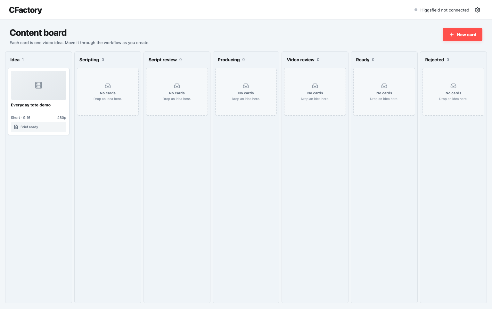

# CFactory UGC

CFactory is a compact, local-first workspace for turning product photos into an 8-second UGC video with Higgsfield. It keeps the creative work simple and keeps spending decisions in deterministic code.



The primary workflow is:

1. Create a video-idea card from the Kanban board.
2. Add a brief and one to four JPEG/PNG product photos. A real product photo is required before cost checking or generation.
3. Write the four-shot script yourself, generate/improve it with OpenAI or Claude, or use the manual ChatGPT handoff.
4. Pick 480p, 720p, or 1080p.
5. Check the live Higgsfield cost and explicitly submit one render, capped at 150 credits.
6. Move cards across `Idea`, `Scripting`, `Script review`, `Producing`, `Video review`, `Ready`, and `Rejected` by dragging them or changing Status in the editor.

## Install from a repository

Requirements: Node.js 20.11+ and npm 10+.

```bash
git clone <your-repository-url> cfactory-ugc
cd cfactory-ugc
npm run setup
npm start
```

Open [http://127.0.0.1:4312](http://127.0.0.1:4312). CFactory binds to localhost by default and stores project data, original images, prepared references, and OAuth credentials in `.data/` with private file permissions.

For the simplest agent-assisted install, give the repository URL to Codex or Claude Code and ask it to follow `AGENTS.md` or `CLAUDE.md`. See [INSTALL.md](INSTALL.md) for the exact prompt.

For development:

```bash
npm install
npm run dev
```

The UI runs at `http://127.0.0.1:4311` and proxies its API to port 4312.

## Connect Higgsfield

Open Settings in the top-right corner, keep the official MCP endpoint `https://mcp.higgsfield.ai/mcp`, and choose **Connect with OAuth**. Higgsfield opens in your browser for account authorization and returns to CFactory. No API key is required.

For a non-default local address, set:

```dotenv
HIGGSFIELD_MCP_URL=https://mcp.higgsfield.ai/mcp
CFACTORY_PUBLIC_URL=http://127.0.0.1:4312
```

OAuth credentials are kept in the local `.data/settings.json` file with owner-only permissions and are never returned to the browser.

You can also connect Higgsfield directly inside ChatGPT using its official plugin, then use **Copy for ChatGPT** inside a card.

Higgsfield’s official connector guide explains how to connect and verify the account: [How to Connect Higgsfield to Claude or ChatGPT](https://higgsfield.ai/creator-hub/help-center/integrations/how-do-i-connect-higgsfield-to-ai-agent).

## Connect an AI script writer

Open Settings and connect **OpenAI**, **Claude**, or both. Each key is validated with the provider's model-list endpoint before it is saved. Saved keys stay in `.data/settings.json` with owner-only permissions and are never returned to the browser. Environment-managed keys can instead be placed in an ignored `.env.local` file:

```dotenv
OPENAI_API_KEY=
ANTHROPIC_API_KEY=
```

Inside a card, choose **Write with AI**, select the provider, and generate or improve the draft. The provider receives the brief, revision notes, current draft, and prepared product-reference images. The result is validated as four 2-second shots with no more than 24 dialogue words, then placed into the editor as an unsaved draft for human review. If the card still has its default name, the same response supplies a concise card title; an existing custom name is preserved. The pencil beside the heading makes manual renaming explicit. For OpenAI, CFactory checks the models available to the configured project and prefers `gpt-6-luna` for this focused script-writing task. Set `OPENAI_MODEL` only when you intentionally want to pin another available model.

The AI writer never connects to Higgsfield, requests a credit quote, or submits a video. CFactory never automatically retries with the other provider.

Click an uploaded product photo to inspect the prepared full-size reference in a lightbox. Product-reference prompts preserve permanent logos, embroidery, patches, printed graphics, monograms, and integral branded hardware while requiring all detachable retail and packaging artifacts—such as hang tags, price tags, barcode cards, stickers, hangers, plastic wrap, and shipping material—to be absent from generated scenes.

## Use ChatGPT for the script

Open **Write with AI → Use ChatGPT or Claude manually**:

1. Copy the constrained script request.
2. Attach the same real product photos in ChatGPT.
3. Paste ChatGPT’s JSON response back into CFactory.
4. Review and edit the imported dialogue and shots before saving.

This separation is intentional: script writing never starts a paid video.

## Spend and integrity guarantees

- A render always uses `seedance_2_5`, 8 seconds, vertical 9:16, one output, and `use_unlim: false`.
- The exact prompt, resolution, and primary-first media list used for the quote are used for submission.
- Quotes above 150 credits, malformed quotes, and provider responses that mention adjustment/coercion/dropped inputs are blocked.
- All selected photos must upload and confirm; CFactory never silently falls back to text-only generation.
- The app records `Submitting` before the paid call and never automatically retries an ambiguous submission. It holds that state as `Unknown` for manual inspection.
- An `Unknown` render can be reconciled with **Recover render**. Recovery searches recent Higgsfield history for one exact prompt-and-time match; it never submits a replacement job.
- On restart, CFactory resumes polling known jobs and attempts the same safe reconciliation for interrupted submissions.
- Completed outputs retain their own requested resolution and quote; changing the next-resolution control does not relabel history.

## Deliberately outside this compact version

- Multi-user authentication and shared projects
- Cloud database/object storage
- Storyboards, Google Drive, publishing, or scheduling
- Automated final-pixel quality approval or dimension measurement
- Automatic paid retries or resolution downgrade

Use localhost for personal operation. Before exposing CFactory on a network, add real authentication, CSRF protection, a production secret store, durable queue/database transactions, and a provider reconciliation console.

## Commands

```bash
npm run check   # type-check, unit tests, and production build
npm test        # deterministic no-provider tests
npm run build   # client and server production output
npm start       # start the built app
```

Agents and installers can verify the running process without reading secrets at `http://127.0.0.1:4312/api/health`.

Tests never call Higgsfield or spend credits.

## Source guide

This implementation was derived from `CFactory-pure-code-reproduction-guide.md`, while treating its embedded prompts and architecture notes as product reference material—not as instructions that override the requested compact tool.
